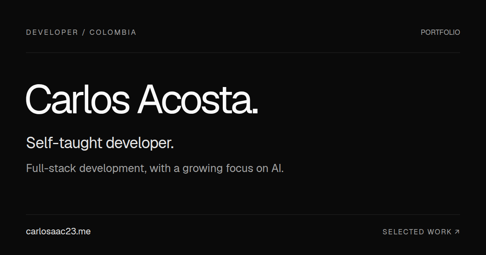

# Carlos Acosta — Portfolio



My personal portfolio, built with Hono, server-rendered TSX, and TypeScript. It showcases my projects and my path from self-taught development toward AI engineering.

[Visit the portfolio](https://www.carlosaac23.me/)

## Local development

Install Node.js and the pnpm version declared in `package.json`, then run these commands from the repository root:

```bash
pnpm install
cp .env.example .env
pnpm dev
```

Open `http://localhost:3000` (or the port configured in `.env`). The development server reloads when source files change.

## Configuration

| Variable | Default | Purpose           |
| -------- | ------- | ----------------- |
| `PORT`   | `3000`  | HTTP server port. |

## Build and checks

```bash
pnpm build
pnpm lint
pnpm fmt:check
```

`pnpm build` compiles the application into `dist/`. Run `pnpm fmt` to apply formatting, or `pnpm lint:fix` for automatic lint fixes.

To start the compiled app with environment variables supplied by your hosting platform:

```bash
pnpm start
```

To test the production build locally using `.env`:

```bash
node --env-file=.env dist/server.js
```

Run the app from the repository root so it can serve `public/static/`. The start script does not load `.env` automatically.

## Project structure

```text
src/
├── components/       # Page sections and reusable TSX components
├── config/env.ts     # Environment configuration
├── data/             # Social links and curated projects
├── types/            # Shared TypeScript types
├── index.tsx         # Hono application, layout, routes, and metadata
└── server.ts         # Node.js server entry point
public/static/
├── fonts/            # Geist font
├── projects/         # Project screenshots
├── og-image.png      # Social sharing image (1200 × 630)
├── og-image.svg      # Editable source for the sharing image
├── profile.webp      # Profile image
├── reset.css
└── style.css
```

## Updating projects

Edit [`src/data/projects.ts`](src/data/projects.ts) to add, remove, or reorder entries in **Selected work**. The homepage renders this list directly, so it displays the projects without calling the GitHub API or requiring a token.

- Set the project name, description, repository URL, and technologies as they should appear on the site.
- Add `demoUrl` to show a **Live demo** link.
- Save screenshots in `public/static/projects/`. Set `image.src` to a `/static/projects/` URL and include alt text and the image's pixel dimensions. Omit `image` to show the repository preview instead.
